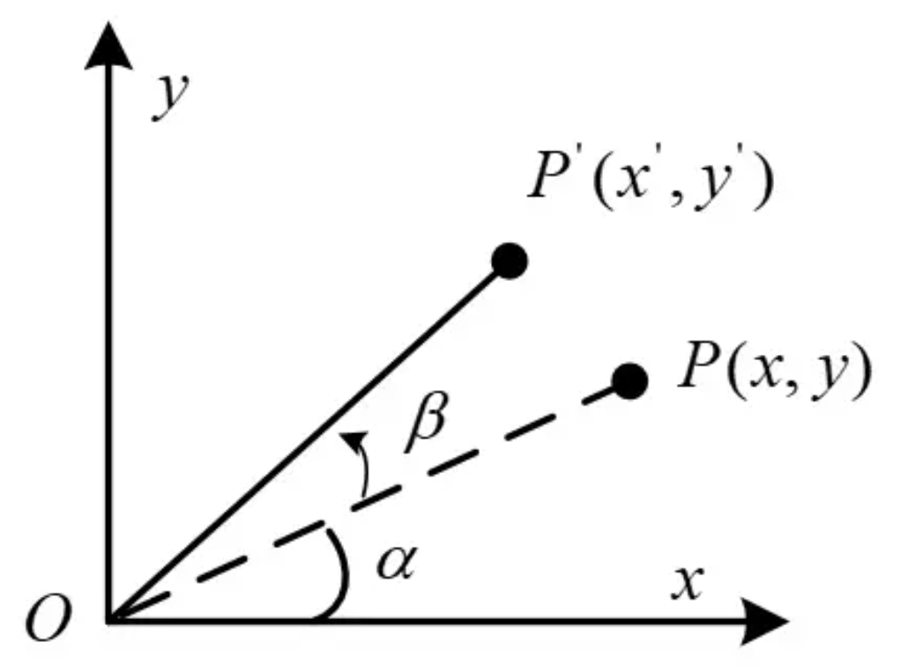

<div align="center">

# 全向底盘运动学逆解算模块

</div>

    全向轮底盘因其自身独特优点在 RoboMaster 比赛中被广泛使用，为此我写了一份清晰明了、易上手、便于移植的全向轮底盘逆解算模块代码，希望能为他人提供一些帮助。
这份代码有**随动模式**和**小陀螺模式**两种控制模式：随动模式的底盘跟随云台指向，底盘坐标系与云台坐标系保持一致；而小陀螺模式的底盘绕自身中心高速自旋，整车在云台坐标系下能完成平移运动，从而达到保证移动的前提下规避规避弹丸的作用。

---

## 目录

- [全向底盘运动学逆解算模块](#全向底盘运动学逆解算模块)
  - [目录](#目录)
  - [文件结构](#文件结构)
  - [坐标系定义](#坐标系定义)
  - [底盘参数配置](#底盘参数配置)
  - [API 说明](#api-说明)
    - [Omni\_Follow\_IK - 随动模式](#omni_follow_ik---随动模式)
    - [Omni\_Spin\_IK - 小陀螺模式](#omni_spin_ik---小陀螺模式)
  - [电机输出顺序](#电机输出顺序)

---

## 文件结构

```
rm-omni-chassis-inverse-kinematics/
├── Omni_IK.h          # 头文件：结构体定义、函数声明
└── Omni_IK.c          # 实现文件：两种模式的逆解算函数
```

---

## 坐标系定义

vx 与 vy 采用**右手坐标系**，并规定 `w` 以逆时针为正方向：

```
                      ^ vx     /_   w
                 fl   |   fr   \  \
            vy     /  |  \         \
            <---------|---------   |
                   \  |  /         /
                 rl   |   rr      /
                      |
```

- `vx`：底盘前进方向（前）
- `vy`：底盘左方向（左）
- `w`：逆时针旋转角速度（正）
- `fl`：前左轮 (front left)
- `fr`：前右轮 (front right)
- `rl`：后左轮 (rear left)
- `rr`：后右轮 (rear right)

---

## 底盘参数配置

在 `Omni_IK.c` 中修改 `Omni_Chassis_Info` 结构体以适配你的底盘：

```c
static const Omni_Chassis_Info_t Omni_Chassis_Info = {
    .chassis_radius = 0.2f,                     // 底盘半径 (m)，轮心到几何中心的水平距离
    .wheel_radius   = 0.152f,                   // 全向轮半径 (m)
    .torque_ratio   = (3591.0f / 187.0f),       // DJI M3508 电机减速比
};
```

| 参数 | 单位 | 说明 |
|---|---|---|
| `chassis_radius` | m | 轮心到底盘几何中心的水平投影距离 |
| `wheel_radius` | m | 全向轮半径 |
| `torque_ratio` | — | 电机减速比（电机转速 / 输出转速） |

---

## API 说明

### Omni_Follow_IK - 随动模式

```c
void Omni_Follow_IK(
    float vx,           // 底盘坐标系 X 轴目标速度 (m/s)
    float vy,           // 底盘坐标系 Y 轴目标速度 (m/s)
    float w,            // 底盘坐标系目标旋转角速度 (rad/s)，需外部 PID 计算
    float output[4]     // 输出各轮电机目标角速度 (rad/s)
);
```

**说明：** 由于底盘跟随云台指向，所以可以直接在底盘坐标系下进行逆解算。写入的参数 `w` 需要先通过一次位置环 PID 计算，使用小陀螺模式中的 `gimbal_angle - fixed_chassis_forward_angle` 来作为误差反馈。

逆解算公式：

```
v_front_left  = -vx + vy + w * R
v_front_right =  vx + vy + w * R
v_rear_left   = -vx - vy + w * R
v_rear_right  =  vx - vy + w * R
```

其中 `R = chassis_radius`。

---

### Omni_Spin_IK - 小陀螺模式

```c
void Omni_Spin_IK(
    float vx,                           // 云台坐标系 X 轴目标速度 (m/s)
    float vy,                           // 云台坐标系 Y 轴目标速度 (m/s)
    float w,                            // 底盘坐标系目标旋转角速度 (rad/s)
    float gimbal_angle,                 // 云台当前角度 (rad)，范围 [-PI, PI]
    float fixed_chassis_forward_angle,  // 底盘正方向角度 (rad)，固定值
    float output[4]                     // 输出各轮电机目标角速度 (rad/s)
);
```

**处理流程：**

1. 计算云台与底盘正方向的角度差：`relative_angle = gimbal_angle - fixed_chassis_forward_angle`
2. 通过二维旋转矩阵将 `(vx, vy)` 从云台坐标系变换到底盘坐标系：



```
vx_chassis(即图中x') = vx(即图中x) * cos(β) - vy(即图中y) * sin(β)
vy_chassis(即图中y') = vx(即图中x) * sin(β) + vy(即图中y) * cos(β)
```

3. 在底盘坐标系下执行四轮全向运动学逆解算（与随动模式相同）

**说明：** `gimbal_angle` 是 yaw 轴电机的编码器当前值或者根据其换算出来的角度，是一个变量。而 `fixed_chassis_forward_angle` 是底盘正方向所对应的 yaw 轴编码器的一个值或者换算的一个角度，是一个固定值，这就需要根据你的实际安装情况来选取了。如果旋转矩阵不理解也没有关系，只要知道并且会用就可以。

---

## 电机输出顺序

`output[4]` 数组的各元素对应的电机位置（需要根据你的实际安装位置修改）：

| 索引 | 对应电机 |
|---|---|
| `output[0]` | 前左电机 (fl) |
| `output[1]` | 后左电机 (rl) |
| `output[2]` | 后右电机 (rr) |
| `output[3]` | 前右电机 (fr) |

**说明：** 这是根据我底盘上不同 ID 的电机的实际安装位置来选取的，一般一条 CAN 信息同时发送底盘的 4 个电机的数据，所以 `output[0]` ~ `output[3]` 分别对应着 `id = 1` ~ `id = 4`。如果你的电机安装位置与我的不同，可以修改等号右边的变量，从而符合你实际的安装位置。

---

## 最后

如果这份代码对您有帮助，麻烦动动您发财的手指，给我点一个免费的star,感谢您的帮助与支持！